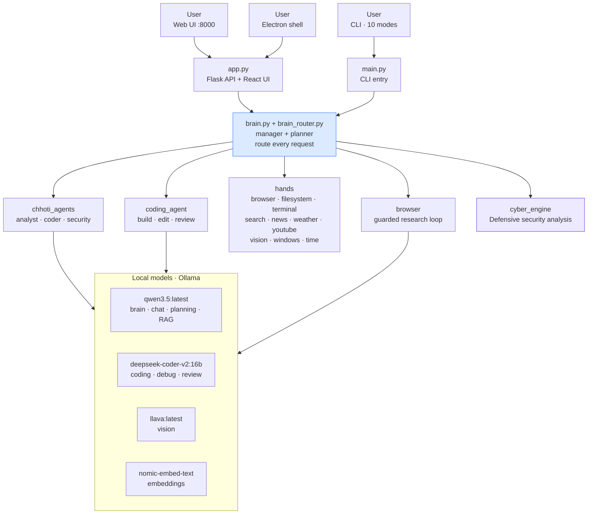
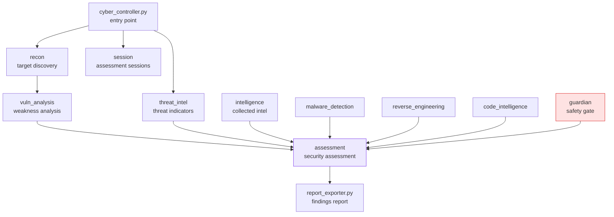
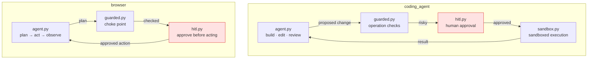
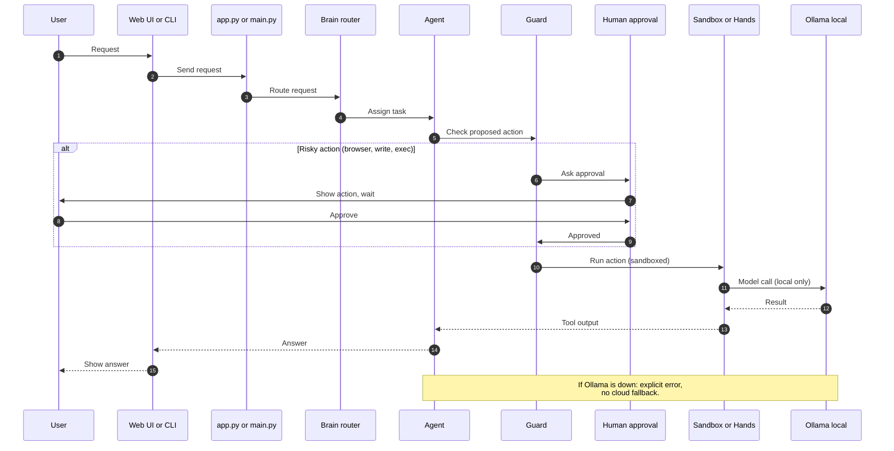
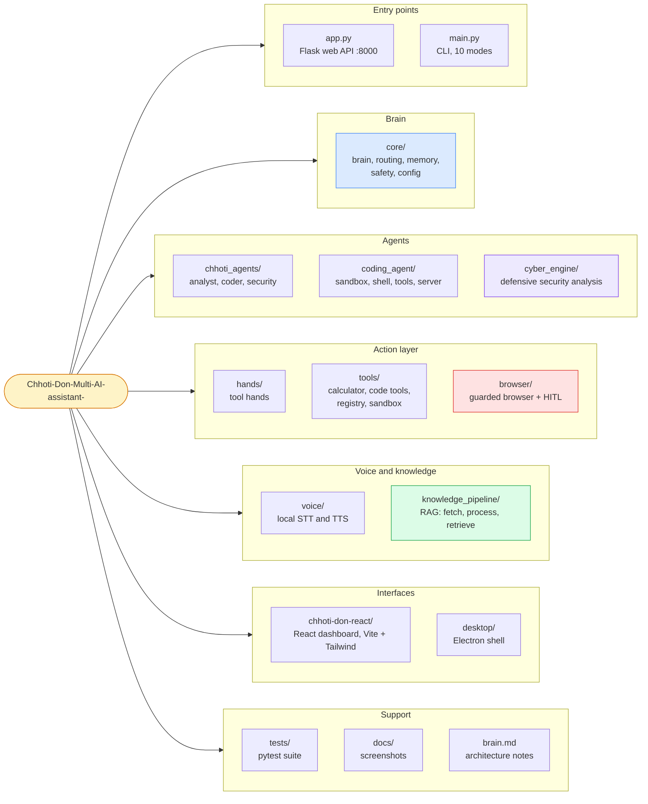

# Chhoti Don — Multi-Agent AI Assistant


---

One connected system, built end to end, running on your own machine:

- **Brain + agents** — a router picks the right agent for each request (chat, coding, analysis, security, research, vision), and every agent runs on a local Ollama model.
- **Hands + tools** — agents act through a hands layer (browser, filesystem, terminal, search, news, weather, YouTube, vision, Windows) and a sandboxed tool layer, never directly on your system.
- **Guarded browser + cyber engine** — browser actions pass a guard choke point with human approval, and the cyber engine does defensive security analysis (recon, vulnerability analysis, threat intel), subsystem by subsystem.
- **Voice + knowledge** — local speech-to-text / text-to-speech, and RAG over your own documents with ChromaDB.

Model inference is 100% local: no cloud LLM, no API key. Live-information hands (search, news, weather, YouTube) make network requests only when you use them. If Ollama is offline, the system returns an explicit error instead of falling back to a cloud model.

---

## Screenshots


---

## Requirements

- Windows 10/11
- Python 3.11+
- Node.js 18+ (for the React dashboard build)
- [Ollama](https://ollama.com) running locally

---

## Quick start (fresh clone)

```bat
git clone https://github.com/bharatkumarhbg2109-alt/Chhoti-Don-Multi-AI-assistant-.git
cd Chhoti-Don-Multi-AI-assistant-
setup.bat
```

`setup.bat` installs Python dependencies, builds the React dashboard, installs the Playwright Chromium browser, and pulls the Ollama models. Then run:

```bat
python app.py
```

Open http://localhost:8000 for the web UI. For the CLI instead (10 interactive modes):

```bat
python main.py
```

### Manual setup (without setup.bat)

```bat
python -m pip install -r requirements.txt
cd chhoti-don-react
npm install
npm run build
cd ..
python -m playwright install chromium
ollama pull qwen3.5:latest
ollama pull deepseek-coder-v2:16b-lite-instruct-q4_K_M
ollama pull llava:latest
ollama pull nomic-embed-text
```

Voice mode is optional:

```bat
python -m pip install -r requirements-voice.txt
python -m voice.download_voice
```

---

## System architecture

### High-level



### Cyber engine



**Responsible use:** Intended for defensive analysis and authorized testing only.

### Coding agent and browser guard



### How a request flows



---

## System prompt design — principles only

The full prompt text lives in the code, not here. What the design guarantees:

| Principle | Implementation |
|---|---|
| **Role per agent** | Every agent prompt names its role first — coding engine, debugging specialist, planning engine, research engine, vision engine, data analytics engine, cybersecurity analysis engine, autonomous coding builder. One agent, one job. |
| **Routed, not guessed** | The brain router and task classifier pick the agent from the request; the planner breaks multi-step work into steps before any agent acts. |
| **Defensive framing** | Security prompts are framed as defensive education and analysis. The cyber guardian and safety policy sit above the prompts, so wording alone can never authorise an unsafe action. |
| **Local-only** | Prompts never reference a cloud model or an API key. If the local model is unavailable, it returns an explicit error instead of falling back to a cloud model. |
| **Guarded execution** | Prompts may propose actions, but browser actions pass the guard choke point, risky coding actions need human approval, and sandboxed execution is the default. |
| **Short, plain answers** | Assistant prompts ask for concise, plain-text answers; summaries are built from real tool output. |

Prompt text lives in each agent module, selected through the brain registry:

- `core/brain.py`, `core/brain_registry.py` — brain selection and per-brain configuration
- `core/planner.py` — planning-engine prompt
- `chhoti_agents/coder.py`, `chhoti_agents/analyst.py`, `chhoti_agents/security.py` — specialist prompts
- `coding_agent/agent.py` — coding-builder prompts

---

## Agents and hands

| Agent | Does |
|---|---|
| Analyst | Data analysis and explanation |
| Coder | Code generation, debugging, review |
| Security | Defensive security analysis (via the cyber engine) |
| Coding agent | Autonomous build / edit / review loop with sandbox + human approval |
| Browser agent | Read-only plan → act → observe research loop (Playwright) |

| Hand | Does |
|---|---|
| browser, filesystem, terminal | Act on the machine, guarded |
| search, news, weather, youtube | Live information gathering |
| vision, windows, time, input | Images, Windows control, time, input |

---

## Models (local-only policy)

| Role | Model |
| ---- | ----- |
| Main brain (chat, reasoning, planning, RAG) | `qwen3.5:latest` |
| Coding (generation, debug, review) | `deepseek-coder-v2:16b-lite-instruct-q4_K_M` |
| Vision (image understanding) | `llava:latest` |
| Navigation brain (browser agent) | `qwen3.5:latest` |
| Embeddings (RAG) | `nomic-embed-text` |

Designed for an 8GB VRAM GPU: `num_ctx: 4096` keeps qwen3.5 (~5.5 GB) fully on GPU. If Ollama is offline, the system returns an explicit error instead of falling back to a cloud model.

---

## Verified numbers

| Measure | Value |
|---|---|
| Python files | 197 |
| Python lines of code | 51,827 |
| Test files | 27 |
| Test functions | 486 |

```bat
python -m pytest tests/ -q
```

Live Ollama tests skip automatically when no Ollama daemon is running (see `tests/test_integration_live.py`). `tests/test_local_only.py` guards the local-only policy: no cloud calls, ever.

---

## Safety, by design

- **Guard choke point** (`browser/guarded.py`) — every browser action is checked before it runs.
- **Human-in-the-loop** (`browser/hitl.py`, `coding_agent/hitl.py`) — risky actions wait for approval.
- **Sandboxed execution** (`coding_agent/sandbox.py`, `tools/sandbox.py`) — code runs contained, not on your live system.
- **Cyber guardian** (`cyber_engine/guardian`) — gates every security assessment.
- **Safety policy** (`core/safety_policy.py`) — one rule set, enforced for every agent.
- **Local-only inference** — Model inference is 100% local: no cloud LLM, no API key. Live-information hands (search, news, weather, YouTube) make network requests only when you use them. Covered by `tests/test_local_only.py`.

---

## Limitations

- Windows-only (Windows 10/11).
- Built for an 8GB VRAM target for the full local model set; smaller GPUs or CPU-only setups will be slower.
- Voice is optional and needs the voice dependencies plus a voice-model download.
- Live-information hands (search, news, weather, YouTube) need internet when you use them.
- Ollama must be running locally; if it is down, the system returns an explicit error instead of falling back to a cloud model.

---

## Project structure



## License

MIT — see [LICENSE](LICENSE).
